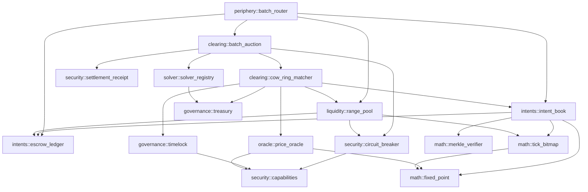
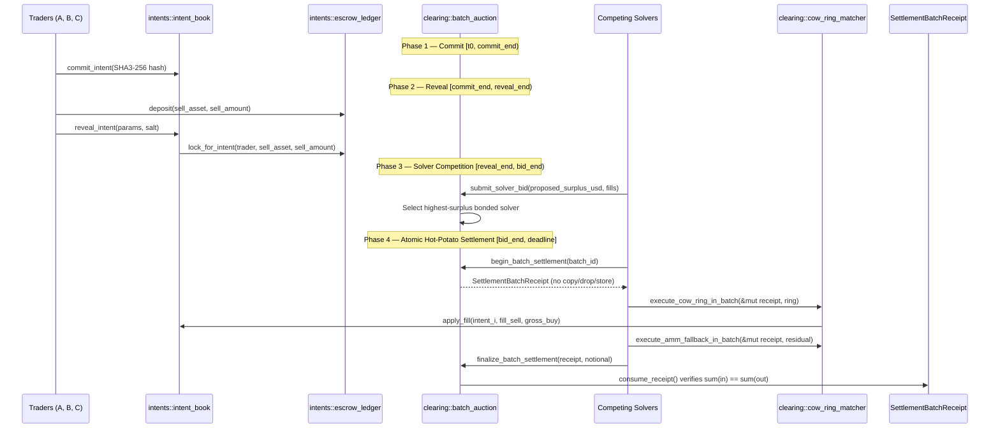

# EquinoxClear

[](https://github.com/ZengLLQ/equinox-clear/actions/workflows/ci.yml)
[](https://opensource.org/licenses/MIT)
[](https://aptoslabs.com)
[](https://move-language.github.io/move)

**EquinoxClear** is a decentralized frequent batch auction (FBA) and Coincidence-of-Wants (CoW) intent clearinghouse featuring SHA3-256 commit-reveal MEV shielding, $k$-hop cyclic ring settlement, Uniform Clearing Price (UCP) enforcement, bonded solver competition with EMA reputation & slashing, concentrated range fallback liquidity with volatility-adaptive dynamic fees, and compile-time linear hot-potato asset conservation.

---

## Table of Contents

1. [Executive Overview](#1-executive-overview)
2. [System Architecture & Execution Sequences](#2-system-architecture--execution-sequences)
3. [Mathematical Formulations & Security Invariants](#3-mathematical-formulations--security-invariants)
4. [Subsystem-by-Subsystem Reference](#4-subsystem-by-subsystem-reference)
5. [CLI Build, Test & Script Walkthrough](#5-cli-build-test--script-walkthrough)
6. [Configuration Parameters & Quantitative Benchmarks](#6-configuration-parameters--quantitative-benchmarks)
7. [7-Bit ASCII Batch Clearing Trace](#7-7-bit-ascii-batch-clearing-trace)
8. [Threat Model, Trade-offs & Known Limitations](#8-threat-model-trade-offs--known-limitations)

---

## 1. Executive Overview

Continuous-time automated market makers leak significant trader surplus to Maximal Extractable Value (MEV) extraction—specifically sandwich attacks, toxic orderflow arbitrage, and Loss-Versus-Rebalancing (LVR). **EquinoxClear** replaces sequential transaction ordering with discrete **Frequent Batch Auctions (FBAs)** where:

1. **Intents remain cryptographically sealed** via domain-separated SHA3-256 commitments during the commit window, neutralizing front-running and solver censorship.
2. **Coincidence-of-Wants (CoW) Ring Settlement** clears 2-way direct swaps and $k$-hop cyclic rings ($A \to B \to C \to A$, up to $k=6$) peer-to-peer at zero AMM swap fee.
3. **Uniform Clearing Price (UCP) Invariance** guarantees every intent on the same directed pair inside a batch settles at an identical clearing rate (within 1 bps integer rounding tolerance).
4. **Concentrated Range Fallback Liquidity** provides an atomic on-chain backstop for unmatched order flow, adjusting swap fees dynamically with an Exponential Moving Average (EMA) of tick volatility.
5. **Linear Hot-Potato Enforcement** binds every settlement transaction to a zero-ability `SettlementBatchReceipt` resource that aborts at VM verification if asset conservation or bid-committed trader surplus fails.

---

## 2. System Architecture & Execution Sequences

### 2.1 Subsystem & Module Dependency Graph



### 2.2 Four-Phase Batch Auction & Fallback Lifecycle



---

## 3. Mathematical Formulations & Security Invariants

### 3.1 Fixed-Point Directed Rounding & Transcendental Calculus

All internal valuations use **WAD** ($W = 10^{18}$) and **RAY** ($R = 10^{27}$) scalings with full 256-bit intermediate products (`u256`) to eliminate premature overflow:

$$\text{mul\_div\_down}(a, b, d) = \left\lfloor \frac{a \cdot b}{d} \right\rfloor, \qquad \text{mul\_div\_up}(a, b, d) = \left\lceil \frac{a \cdot b + d - 1}{d} \right\rceil$$

Integer square roots $\lfloor \sqrt{x} \rfloor$ use bit-length-seeded Babylonian Newton-Raphson convergence:

$$z_{k+1} = \left\lfloor \frac{z_k + \lfloor x / z_k \rfloor}{2} \right\rfloor$$

Exponential weighting $\exp(x)$ over $x \in [0, 20W]$ performs range reduction $x = k \ln(2) + r$ ($|r| \le \frac{\ln 2}{2}$) and evaluates a 12-term Taylor expansion:

$$e^x = 2^k \sum_{n=0}^{12} \frac{r^n}{n!}$$

### 3.2 Commit-Reveal Cryptographic Sealing

Each trading intent is sealed prior to batch reveal via domain-separated SHA3-256:

$$H = \text{SHA3-256}\Big(\text{DOMAIN} \parallel \text{BCS}(\text{trader}) \parallel \text{BCS}(a_{\text{sell}}) \parallel \text{BCS}(a_{\text{buy}}) \parallel \text{BCS}(S) \parallel \text{BCS}(B_{\min}) \parallel \text{BCS}(\text{pf}) \parallel \text{BCS}(f_{\max}) \parallel \text{BCS}(\tau_{\text{exp}}) \parallel \text{salt}\Big)$$

### 3.3 Exact Cross-Multiplied Limit Price & Surplus-Only Fee Invariant

For any partial or full fill $(s, b_{\text{gross}})$ of an intent specifying $(S, B_{\min})$, the protocol first enforces pro-rata minimum output:

$$b_{\min}^{\text{pro-rata}} = \left\lceil \frac{B_{\min} \cdot s}{S} \right\rceil, \qquad b_{\text{gross}} \ge b_{\min}^{\text{pro-rata}}$$

Protocol fees $\phi$ are charged **exclusively on positive trader surplus** $\Delta = b_{\text{gross}} - b_{\min}^{\text{pro-rata}}$:

$$\phi = \left\lfloor \frac{\Delta \cdot f_{\text{protocol}}}{10\,000} \right\rfloor, \qquad b_{\text{net}} = b_{\text{gross}} - \phi$$

Finally, the net output must strictly satisfy the exact cross-multiplied limit inequality with zero rounding erosion:

$$b_{\text{net}} \cdot S \ge B_{\min} \cdot s$$

### 3.4 Cyclic Coincidence-of-Wants (CoW) Conservation & UCP Invariance

Consider a $k$-hop cyclic ring ($2 \le k \le 6$) of intents $(I_0, I_1, \dots, I_{k-1})$. The clearing engine enforces:

1. **Asset Continuity**: $a_{\text{buy}}(I_i) = a_{\text{sell}}(I_{(i+1)\bmod k})$ for all $i \in \{0, \dots, k-1\}$.
2. **Exact Flow Conservation**: $b_{\text{gross}}(I_i) = s(I_{(i+1)\bmod k})$ for all $i \in \{0, \dots, k-1\}$.
3. **Uniform Clearing Price (UCP) Consistency**: For every fill on directed pair $(u, v)$ in batch $t$, let $r = \text{round}(b_{\text{gross}} \cdot W / s)$. All fills on $(u, v)$ in batch $t$ must satisfy:

$$\frac{|r - r_{\text{UCP}}^{(t)}(u, v)|}{r_{\text{UCP}}^{(t)}(u, v)} \cdot 10\,000 \le 1\text{ bps}$$

### 3.5 Oracle Reference Band & Circular TWAP Guard

For oracle-tracked pairs, the clearing rate $r$ must remain bounded within $\delta_{\max}$ (governed via timelock) of both the live outlier-resistant median $P_{\text{med}}$ and the 16-slot circular-buffer TWAP $P_{\text{TWAP}}$:

$$\frac{|r - P_{\text{med}}|}{P_{\text{med}}} \le \delta_{\max} \quad \land \quad \frac{|r - P_{\text{TWAP}}|}{P_{\text{TWAP}}} \le \delta_{\max}$$

### 3.6 Concentrated Range Fallback & Dynamic Volatility Fee

Discrete ticks $t \in [0, 8192]$ represent signed shifts $t - 4096 \in [-4096, +4096]$ with multiplicative 10 bps spacing:

$$P(t) = W \cdot (1.001)^{t - 4096}$$

Swap execution updates EMA tick volatility $\sigma_k$ ($\lambda = 0.80$) and sets the dynamic fee:

$$\sigma_k = \lambda \sigma_{k-1} + (1 - \lambda)|t_k - t_{k-1}|, \qquad f_{\text{dyn}} = \min\!\left(f_{\max},\; f_{\text{base}} + k_{\text{vol}} \cdot \lfloor \sigma_k \rfloor\right)$$

### 3.7 Global Escrow Conservation Invariant

Across every deposit, intent lock, unlock, CoW ring clear, range pool swap, LP harvest, and treasury fee split, `escrow_ledger` guarantees for every registered `asset_id`:

$$R_{\text{total}}(a) = B_{\text{available}}(a) + B_{\text{locked}}(a) + R_{\text{AMM}}(a) + F_{\text{treasury}}(a)$$

### 3.8 Solver EMA Reputation & Slashing Dynamics

On timely batch settlement, solver reputation $R_s \in [0, W]$ updates via $\alpha = 0.20$:

$$R_s^{(k)} = \min\!\left(W,\; (1 - \alpha) R_s^{(k-1)} + \alpha W\right)$$

If a winning solver misses `settle_deadline`, any fallback solver triggers deterministic slashing: bond decays by `slash_bps` (transferred to `treasury`), reputation halves ($R_s \leftarrow R_s / 2$), and the solver is jailed for `3600s`.

---

## 4. Subsystem-by-Subsystem Reference

| Subsystem | Module | Key Types & State | Primary Responsibilities |
| :--- | :--- | :--- | :--- |
| **Math & Crypto** | `fixed_point` | WAD/RAY constants | Directed `mul_div`, `sqrt_u256`, `pow_wad`, `exp_wad`, `ln_wad` |
| **Math & Crypto** | `signed_delta` | `I128` | Sign-magnitude signed arithmetic with canonical zero |
| **Math & Crypto** | `tick_bitmap` | `TickBitmap`, `Table<u64, u256>` | $O(1)$ MSB/LSB bit-scan word traversal across 8,193 ticks |
| **Math & Crypto** | `merkle_verifier` | Domain-prefixed SHA3-256 | Intent/bid sealing & canonical sorted-pair Merkle proof verification |
| **Security** | `capabilities` | `RoleRegistry` | Two-step Admin transfer, Guardian, Governance, OracleFeeder ACL |
| **Security** | `circuit_breaker` | `BreakerState` | Global/per-pair pause & sliding-window USD volume rate limiter |
| **Security** | `settlement_receipt` | `SettlementBatchReceipt` | Zero-ability hot potato enforcing exact asset delta & bid surplus |
| **Events** | `events` | 18 `#[event]` structs | Full audit trail across intents, rings, swaps, slashing, governance |
| **Governance** | `timelock` | `TimelockState`, `QueuedAction` | Delayed parameter queue (`3600s–604800s`) with `86400s` grace period |
| **Governance** | `treasury` | `TreasuryState`, `AssetRevenue` | Tri-bucket fee split (Reserve / Solver Rebate / LP Incentive) |
| **Oracle** | `price_oracle` | `OracleRegistry`, `PairFeed` | Multi-feeder median, confidence spread check, staleness, 16-slot TWAP |
| **Solver Network** | `solver_registry` | `SolverRegistryState`, `SolverProfile` | Collateral bonding, 24h unbonding cooldown, EMA reputation, slashing |
| **Intents & Escrow** | `escrow_ledger` | `EscrowLedgerState`, `AssetSupply` | Multi-asset isolated vaults with global conservation verification |
| **Intents & Escrow** | `intent_book` | `IntentBookState`, `IntentOrder` | Commit-reveal validation, partial fills, tick indexing, cancel refunds |
| **Liquidity** | `range_pool` | `RangePoolRegistry`, `PoolState`, `LpPosition` | Concentrated range positions, $x \cdot y$ swaps, volatility fees, fee growth |
| **Clearing** | `cow_ring_matcher` | `BatchUcpTable`, `PairUcpRecord` | $k$-hop cyclic CoW verification, UCP enforcement, AMM fallback routing |
| **Clearing** | `batch_auction` | `ClearinghouseState`, `BatchEpoch` | 4-phase epoch state machine, solver bid ranking, fallback recovery |
| **Periphery** | `batch_router` | Entry & view lenses | Atomic protocol bootstrap, deposit+commit, cancel+withdraw, 2-way helper |

---

## 5. CLI Build, Test & Script Walkthrough

### 5.1 Prerequisites
- **Aptos CLI** `>= 6.0.1`
- Dependencies pinned in `Move.toml` (`AptosFramework` `aptos-release-v1.16`).

### 5.2 Compile & Run Test Suite

```bash
# Compile all 18 source modules and 4 transaction scripts
aptos move compile --dev

# Execute the complete unit, lifecycle, and stateful conservation test suite
aptos move test
```

### 5.3 Transaction Scripts (`scripts/`)

| Script | Purpose | Key Calls |
| :--- | :--- | :--- |
| `scripts/initialize_protocol.move` | Bootstrap governance, oracle, escrow, and initial pool | `batch_router::initialize_protocol`, `escrow_ledger::register_asset`, `price_oracle::register_pair`, `range_pool::create_pool` |
| `scripts/commit_reveal_intent.move` | Deposit collateral, commit SHA3-256 intent hash, and reveal | `merkle_verifier::compute_intent_commitment`, `batch_router::deposit_and_commit_intent`, `intent_book::reveal_intent` |
| `scripts/settle_cow_batch.move` | Settle a 3-way cyclic CoW ring under hot-potato receipt | `batch_auction::begin_batch_settlement`, `execute_cow_ring_in_batch`, `finalize_batch_settlement` |
| `scripts/manage_range_liquidity.move` | Deposit dual assets, mint range position, harvest fees | `batch_router::deposit_and_mint_range_position`, `range_pool::collect_position_fees` |

---

## 6. Configuration Parameters & Quantitative Benchmarks

### 6.1 Default Protocol Parameters

| Parameter | Default Value | Governance Control |
| :--- | :--- | :--- |
| `commit_duration_sec` / `reveal_duration_sec` | `60s` / `60s` | `batch_auction::update_epoch_config` |
| `bid_duration_sec` / `settle_duration_sec` | `30s` / `60s` | `batch_auction::update_epoch_config` |
| `surplus_fee_bps` | `500` (5% of positive surplus only) | `timelock::queue_action` |
| `oracle_max_deviation_bps` | `300` (3.00% band vs median & TWAP) | `timelock::queue_action` |
| `slash_bps` / `JAIL_DURATION_SEC` | `1000` (10% bond) / `3600s` | `solver_registry` |
| `treasury` revenue split | `50%` Reserve / `30%` Solver / `20%` LP | `treasury::update_splits` |
| `TWAP_BUFFER_CAP` | `16` circular checkpoints | `price_oracle` |

### 6.2 Numerical Precision & Verification Matrix

| Primitive / Invariant | Verification Scope | Observed Bound / Result |
| :--- | :--- | :--- |
| `fixed_point::exp_wad` | Range $x \in [0, 20W]$ | Relative error $< 10^{-13}$ vs IEEE-754 double |
| `fixed_point::ln_wad` | Range $x \ge 1W$ | Relative error $< 10^{-13}$ via 8-term `atanh` fold |
| `fixed_point::sqrt_wad` | Perfect & irrational roots | Exact floor within $\le 2$ wei ($2 \times 10^{-18}$) |
| `tick_bitmap` scan | Sparse cross-word traversal (`8193` ticks) | $O(1)$ bit-mask scan per 256-bit word |
| `escrow_ledger` conservation | Multi-epoch mixed CoW + AMM + cancels | `total_reserves == avail + locked + amm + fees` exact |
| `SettlementBatchReceipt` | Compile-time linear Move resource | Unbalanced batch or unmet bid aborts VM tx |

---

## 7. 7-Bit ASCII Batch Clearing Trace

Representative output illustrating a hybrid batch clearing a 3-way CoW ring plus a residual concentrated range-pool tap:

```text
+==============================================================================+
| EQUINOXCLEAR :: BATCH #0001 SETTLEMENT TRACE                                 |
+==============================================================================+
| Phase Timeline : Commit[0..60] -> Reveal[60..120] -> Bid[120..150] -> Settle |
| Winning Solver : 0x0502 (Reputation: 0.6000 -> 0.6800 WAD, Bond: 2000 USDC)  |
+------------------------------------------------------------------------------+
| [1] CYCLIC CoW RING (3-HOP ZERO-AMM-FEE MATCH)                               |
|     Intent #1 (Alice) : 1000.00 A1  --->  10.00 A2  (Limit >= 9.50, +0.50)   |
|     Intent #2 (Bob)   :   10.00 A2  --->  20.00 A3  (Limit >= 19.00, +1.00)  |
|     Intent #3 (Carol) :   20.00 A3  ---> 1000.00 A1 (Limit >= 980.0, +20.0)  |
|     Cycle Delta Check : A1(1000=1000), A2(10=10), A3(20=20)          [PASS]  |
|     UCP Band Check    : Within 300 bps of Oracle Median & 16-TWAP    [PASS]  |
+------------------------------------------------------------------------------+
| [2] RESIDUAL CONCENTRATED RANGE POOL FALLBACK (POOL #1: A1 / A2)             |
|     Intent #4 (Dave)  :  200.00 A1  ---> 199.00 A2  (DynFee: 30 bps) [PASS]  |
+------------------------------------------------------------------------------+
| [3] LINEAR HOT-POTATO RECEIPT & GLOBAL CONSERVATION AUDIT                    |
|     Total Surplus Delivered : 115.00 USD                                     |
|     Escrow Conservation A1  : reserves == avail + locked + amm + fee [EXACT] |
|     Escrow Conservation A2  : reserves == avail + locked + amm + fee [EXACT] |
|     Escrow Conservation A3  : reserves == avail + locked + amm + fee [EXACT] |
+==============================================================================+
```

---

## 8. Threat Model, Trade-offs & Known Limitations

- **Internal Ledger vs. Native Coin/FungibleAsset Adapter**: To support multi-hop cyclic CoW rings across arbitrary asset sets cleanly in deterministic Move verification without requiring per-pair generic type proliferation, `escrow_ledger` maintains isolated asset-ID accounting (`u64`) paired with strict conservation checks. Production mainnet deployment binds `deposit`/`withdraw` entrypoints to Aptos `FungibleAsset` primary stores via a thin token-custody wrapper.
- **Off-Chain Solver Discovery**: EquinoxClear deliberately keeps combinatorial NP-hard CoW ring finding off-chain; the on-chain Move engine focuses on $O(k)$ cycle verification, UCP invariance, oracle band enforcement, and linear hot-potato settlement.
- **Single-Asset Bond Denomination**: Solver bonds are currently denominated in a single configured `bond_asset_id` (e.g., USDC) rather than multi-collateral solver baskets.
- **Discrete Tick Range Granularity**: `tick_bitmap` spans 8,193 discrete ticks at 10 bps multiplicative spacing ($1.001^{\pm 4096} \approx [0.0166, 60.06]$ relative to base WAD); ultra-volatile pairs exceeding $60\times$ relative price drift require re-anchoring or multi-pair routing.
